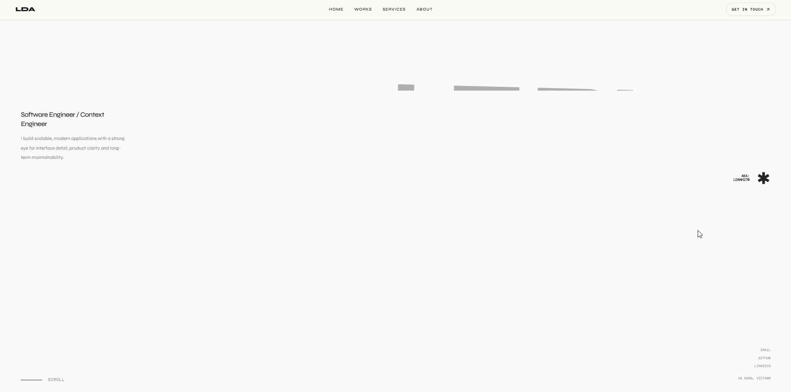

<h1 align="center">👋 Hi, I'm Lê Đức Anh</h1>

<p align="center">
  Software Engineer | Competitive Programming | Fullstack Developer
</p>

<p align="center">
  
  
  
  
</p>

<br>

<p align="center">
  <a href="https://ldadev.vercel.app/" target="_blank">
    
  </a>
</p>

<br>

<h1 align="center">CONTACTS</h1>

<p align="center">
  <a href="https://ldadev.vercel.app/" target="_blank"></a>
  <a href="https://facebook.com/ldanh170" target="_blank"></a>
  <a href="https://linkedin.com/in/ldanh170" target="_blank"></a>
  <a href="mailto:ducanhle.dn@gmail.com" target="_blank"></a>
  <a href="https://github.com/ldanh270" target="_blank"></a>
  <a href="https://t.me/ldanh270" target="_blank"></a>
</p>

<br>

<h1 align="center">TECH STACKS</h1>

<table align="center">
<tr>
<td align="left"><b>Languages</b></td>
<td>
  
  
  
  
  
  
  
  
</td>
</tr>

<tr>
<td align="left"><b>Frontend</b></td>
<td>
  
  
  
  
  
  
  
</td>
</tr>

<tr>
<td align="left"><b>Web3</b></td>
<td>
  
</td>
</tr>

<tr>
<td align="left"><b>Backend</b></td>
<td>
  
  
  
  
</td>
</tr>

<tr>
<td align="left"><b>Database</b></td>
<td>
  
  
  
</td>
</tr>

<tr>
<td align="left"><b>CI/CD</b></td>
<td>
  
  
  
  
  
  
  
  
  
</td>
</tr>

<tr>
<td align="left"><b>Tools</b></td>
<td>
  
  
  
</td>
</tr>

<tr>
<td align="left"><b>Agent & AI</b></td>
<td>
  
  
  
</td>
</tr>
</table>

<br>

<h1 align="center">MY STATS</h1>

<p align="center">
  
</p>

<p align="center">
  
  
</p>

<p align="center">
  
  
</p>

<br>

<h1 align="center">WAKATIME STATS</h1>

<!--START_SECTION:waka-->


**🐱 My GitHub Data** 

> 📦 268.6 kB Used in GitHub's Storage 
 > 
> 🏆 1,897 Contributions in the Year 2026
 > 
> 💼 Opted to Hire
 > 
> 📜 19 Public Repositories 
 > 
> 🔑 15 Private Repositories 
 > 
**I'm an Early 🐤** 

```text
🌞 Morning                1395 commits        █████░░░░░░░░░░░░░░░░░░░░   19.16 % 
🌆 Daytime                2602 commits        █████████░░░░░░░░░░░░░░░░   35.74 % 
🌃 Evening                2825 commits        ██████████░░░░░░░░░░░░░░░   38.80 % 
🌙 Night                  458 commits         ██░░░░░░░░░░░░░░░░░░░░░░░   06.29 % 
```
📅 **I'm Most Productive on Saturday** 

```text
Monday                   882 commits         ███░░░░░░░░░░░░░░░░░░░░░░   12.12 % 
Tuesday                  1154 commits        ████░░░░░░░░░░░░░░░░░░░░░   15.85 % 
Wednesday                816 commits         ███░░░░░░░░░░░░░░░░░░░░░░   11.21 % 
Thursday                 1234 commits        ████░░░░░░░░░░░░░░░░░░░░░   16.95 % 
Friday                   610 commits         ██░░░░░░░░░░░░░░░░░░░░░░░   08.38 % 
Saturday                 1501 commits        █████░░░░░░░░░░░░░░░░░░░░   20.62 % 
Sunday                   1083 commits        ████░░░░░░░░░░░░░░░░░░░░░   14.88 % 
```


📊 **This Week I Spent My Time On** 

```text
🕑︎ Time Zone: Asia/Ho_Chi_Minh

💬 Programming Languages: 
PHP                      3 hrs 22 mins       ████████░░░░░░░░░░░░░░░░░   31.57 % 
CSS                      1 hr 53 mins        ████░░░░░░░░░░░░░░░░░░░░░   17.71 % 
Other                    1 hr 43 mins        ████░░░░░░░░░░░░░░░░░░░░░   16.06 % 
TypeScript               1 hr 31 mins        ████░░░░░░░░░░░░░░░░░░░░░   14.30 % 
Markdown                 1 hr 9 mins         ███░░░░░░░░░░░░░░░░░░░░░░   10.78 % 

🔥 Editors: 
Codex Vscode             8 hrs 27 mins       ████████████████████░░░░░   78.91 % 
VS Code                  1 hr 38 mins        ████░░░░░░░░░░░░░░░░░░░░░   15.28 % 
Antigravity Desktop      37 mins             █░░░░░░░░░░░░░░░░░░░░░░░░   05.81 % 

🐱‍💻 Projects: 
loan-thanh-dung          5 hrs 29 mins       █████████████░░░░░░░░░░░░   51.31 % 
linko                    2 hrs 30 mins       ██████░░░░░░░░░░░░░░░░░░░   23.39 % 
zotek8-website           1 hr 42 mins        ████░░░░░░░░░░░░░░░░░░░░░   15.92 % 
git-editor               43 mins             ██░░░░░░░░░░░░░░░░░░░░░░░   06.80 % 
dev-core-erp             16 mins             █░░░░░░░░░░░░░░░░░░░░░░░░   02.59 % 

💻 Operating System: 
Windows                  10 hrs 42 mins      █████████████████████████   100.00 % 
```

🤖 **AI Coding This Week** 

```text
⏱ AI Coding Time: 10 hrs 26 mins (97.51%)

✍️ 3,380 lines written by AI, 2,553 lines written by hand (56.97% AI-written)

🔤 3,516,365 Input Tokens, 437,214 Output Tokens

💵 $28.27 Estimated AI Cost This Week

🧠 35 AI Sessions, 144 AI Prompts

GPT                      3,516 lines         █████████████████████████   100.00 % 
Gemini                   0 lines             ░░░░░░░░░░░░░░░░░░░░░░░░░   00.00 % 

🔎 AI Coding Insights:
⚖️ Balanced with AI — 56.97% of written lines came from AI
📚 Verbose Prompter — average 2,130 characters per prompt
🔁 Iterative Prompter — average 4 prompts per session
🔍 Hands-On Reviewer — 59.05% of changed lines were hand-edited
```

**I Mostly Code in TypeScript** 

```text
TypeScript               20 repos            ███████████░░░░░░░░░░░░░░   45.45 % 
JavaScript               10 repos            ██████░░░░░░░░░░░░░░░░░░░   22.73 % 
Python                   4 repos             ██░░░░░░░░░░░░░░░░░░░░░░░   09.09 % 
Java                     3 repos             ██░░░░░░░░░░░░░░░░░░░░░░░   06.82 % 
Kotlin                   1 repo              █░░░░░░░░░░░░░░░░░░░░░░░░   02.27 % 
```


 Last Updated on 09/11/2026 04:51:37 UTC
<!--END_SECTION:waka-->
